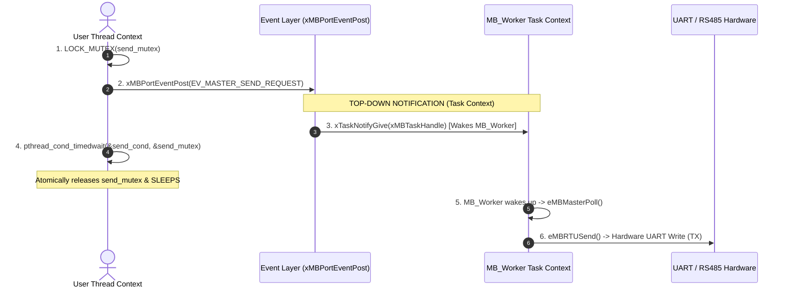
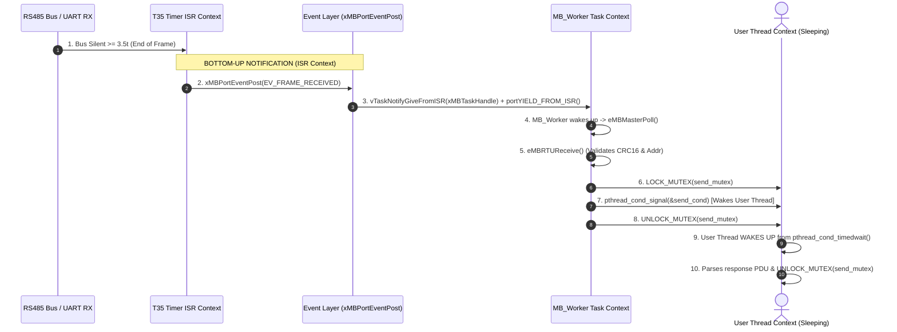

# RS485 Modbus Transmission & Reception Process Flow

---

## 1. Why `send_and_wait_logic()` is Designed This Way

### The Race Condition Problem (Lost Wakeup)
If a thread posted an event **before** acquiring the lock to sleep:
```
  [User Thread]                           [Hardware / Worker Task]
        |                                             |
  xMBPortEventPost(EV_MASTER_SEND_REQUEST)            | 
        |                                             |
        | ---- (Frame sent & response arrives FAST) ->|
        |                                       EV_FRAME_RECEIVED arrives!
        |                                       pthread_cond_signal(&send_cond)  <-- SIGNAL LOST!
        v                                             | (No thread was sleeping yet)
  pthread_cond_timedwait(&send_cond, ...)             |
  (SLEEPS until timeout!) ----------------------------+
```
If `pthread_cond_signal()` occurs before `pthread_cond_timedwait()`, the signal is lost and the thread sleeps until timeout even though the frame arrived! (X)
By using mutexlock, the thread always waked up by `pthread_cond_signal()` if recive arrvied before timeout.

### The Solution: Locking `send_mutex` Before `xMBPortEventPost()`
Your code in `send_and_wait_logic()` prevents this race condition by taking `send_mutex` **FIRST**:

```
  [User Thread Context]                                     [MB_Worker / ISR Context]
           |                                                           |
   LOCK_MUTEX(send_mutex)                                              |
           |                                                           |
   xMBPortEventPost(EV_MASTER_SEND_REQUEST)                            |
           |                                                           |
   pthread_cond_timedwait(&send_cond, &send_mutex)                     |
   (Atomically releases send_mutex & SLEEPS)                           |
           ^                                                           |
           |                                              LOCK_MUTEX(send_mutex)
           |                                              (Blocked until User Thread is asleep)
           |                                                           |
           |                                              pthread_cond_signal(&send_cond)
           +--------------------------------------------- UNLOCK_MUTEX(send_mutex)
                     (Thread Wakes Up Safely!)
```

By holding `send_mutex` when calling `xMBPortEventPost()`, the `MB_Worker` task **cannot signal** `send_cond` until `pthread_cond_timedwait()` atomically releases `send_mutex` and puts the User Thread to sleep.

---

## 2. Direction of Notifications & Task Signals

There are two completely separate directional flows:

1. **Top-Down Request Flow** (`User Thread` $\rightarrow$ `xMBPortEventPost` $\rightarrow$ `xTaskNotifyGive` $\rightarrow$ `MB_Worker Task`)
2. **Bottom-Up Response Flow** (`ISR` $\rightarrow$ `vTaskNotifyGiveFromISR` $\rightarrow$ `MB_Worker Task` $\rightarrow$ `pthread_cond_signal` $\rightarrow$ `User Thread`)

---

### Flow 1: Top-Down Request Flow (User Thread to Hardware)



---

### Flow 2: Bottom-Up Response Flow (Hardware / ISR to User Thread)



---

## 3. Complete End-to-End Context Map

```
====================================================================================================
1. USER THREAD CONTEXT
====================================================================================================
  ModbusSend()
    │
    ├──► 1. LOCK_MUTEX(master_lock)         <-- Mutex between user threads
    ├──► 2. LOCK_MUTEX(send_mutex)         <-- Mutex protecting condition variable
    ├──► 3. xMBPortEventPost(EV_MASTER_SEND_REQUEST)
    │           │
    │           └─────────────┐ (Top-Down Notification via xTaskNotifyGive)
    │                         │
    ├──► 4. pthread_cond_timedwait(&send_cond, &send_mutex)
    │       (Atomically releases send_mutex & SLEEPS)
    │                                                           │
    │  =========================================================│===================================
    │  2. FREE RTOS WORKER TASK CONTEXT (MB_Worker)             │
    │  =========================================================│===================================
    │                                                           v
    │       prvModbusWorkerTask() / ModbusRun() <───────────────┘
    │         │
    │         ├──► eMBMasterPoll()
    │         │      │
    │         │      ├──► eMBRTUSend() ──► UART TX Write (DE=1) ──► Physical RS485 Bus
    │         │      │
    │         │      └──► master_state = EM_WFR (Waiting For Reply)
    │         │
    │  =============================================================================================
    │  3. HARDWARE & ISR CONTEXT (Slave Transmits Response)
    │  =============================================================================================
    │       Physical RS485 Bus ──► UART RX ──► HardwareSerial.onReceive ISR (xMBRTUReceiveFSM(mb))
    │                                                    │ (Restarts T35 timer per byte)
    │                                                    v
    │                                          T35 Timer Expiration ISR (test_hrtimer_handler)
    │                                                    │
    │                                                    ├──► xMBRTUTimerT35Expired()
    │                                                    └──► xMBPortEventPost(EV_FRAME_RECEIVED)
    │                                                               │
    │  =============================================================│===============================
    │  4. RETURN TO WORKER TASK CONTEXT                             │
    │  =============================================================│===============================
    │                                                               v
    │       MB_Worker Wakes Up (via vTaskNotifyGiveFromISR) ────────┘
    │         │
    │         ├──► eMBMasterPoll()
    │         ├──► eMBRTUReceive() (Validates CRC16 & Slave Address)
    │         ├──► LOCK_MUTEX(send_mutex)
    │         ├──► pthread_cond_signal(&send_cond) ──┐
    │         └──► UNLOCK_MUTEX(send_mutex)          │ (Bottom-Up Wakeup Signal)
    │                                                │
    │  ==============================================│==============================================
    │  5. RETURN TO USER THREAD CONTEXT              │
    │  ==============================================│==============================================
    v                                                v
  User Thread Wakes Up from pthread_cond_timedwait() ─┘
    │
    ├──► Check master_state == EM_PR
    ├──► Parse PDU response (LightModbus)
    ├──► UNLOCK_MUTEX(send_mutex)
    └──► UNLOCK_MUTEX(master_lock) ──► Return to caller application
====================================================================================================
```

---

## 4. Summary Table of Signals & Notifications

| Signal Name | Sender Context | Receiver Context | Direction | Purpose |
| :--- | :--- | :--- | :--- | :--- |
| `xTaskNotifyGive(xMBTaskHandle)` | **User Thread** | **MB_Worker Task** | Top-Down | Notifies worker task that a user request (`EV_MASTER_SEND_REQUEST`) needs transmission. |
| `vTaskNotifyGiveFromISR(xMBTaskHandle)` | **T35 Timer ISR** | **MB_Worker Task** | Bottom-Up | Notifies worker task from ISR context that a full frame (`EV_FRAME_RECEIVED`) was captured. |
| `pthread_cond_signal(&send_cond)` | **MB_Worker Task** | **User Thread** | Bottom-Up | Unblocks the sleeping User Thread once the response frame has been processed & validated. |
